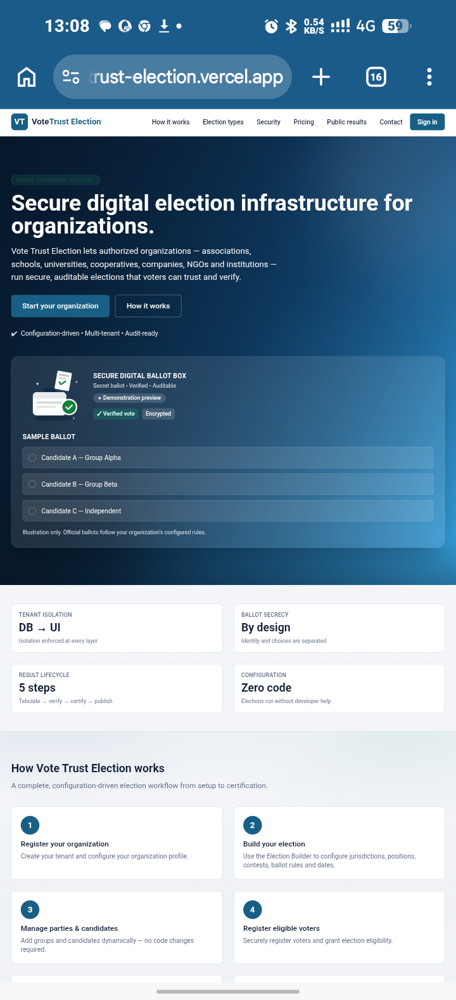
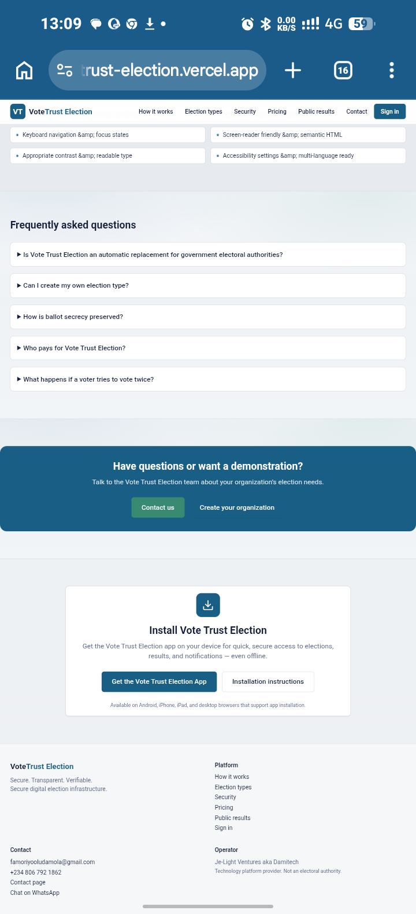
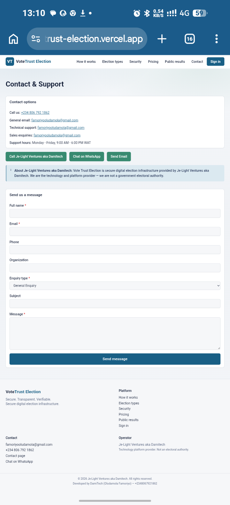

# VoteTrust Election: Secure Digital Elections

A secure, multi-tenant e-voting platform for associations, schools and organisations that want to run elections online with trust and transparency.

**Live site:** https://votetrust-election.vercel.app

**Status:** Pre-launch. A personal product being prepared for launch as a subscription service.

## What it does

- An election builder that lets an organisation set up its own election.

- Voter registration, with server-side checks that prevent duplicate voting.

- Ballot secrecy by design: voter identity and ballots are stored separately.

- An append-only audit trail, plus a verify, certify and publish workflow for results.

- A public results page, so everyone can see the outcome.

- Separate data for each organisation (multi-tenant), and installable on phones and desktops.

## Tech stack

React, Next.js, TypeScript, Node.js, Express, PostgreSQL, Tailwind CSS, Progressive Web App (PWA) technologies, deployed on Vercel.

## Screenshots

## Source code

The source code is private because the platform handles election security. I am happy to walk through the design in an interview or share access on request.

## Author

Oludamola Micheal Famoriyo, Osogbo, Nigeria

Email: famoriyooludamola@gmail.com

LinkedIn: https://www.linkedin.com/in/oludamola-famoriyo-ab951a416
